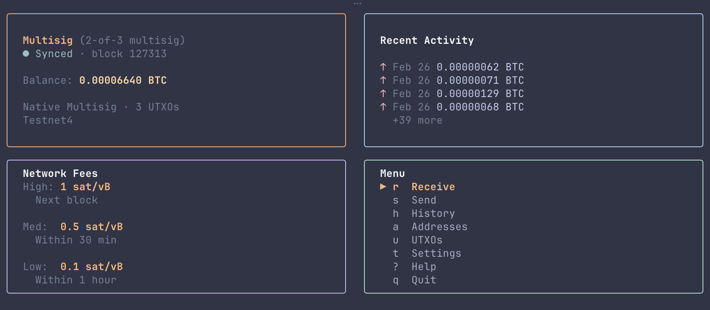
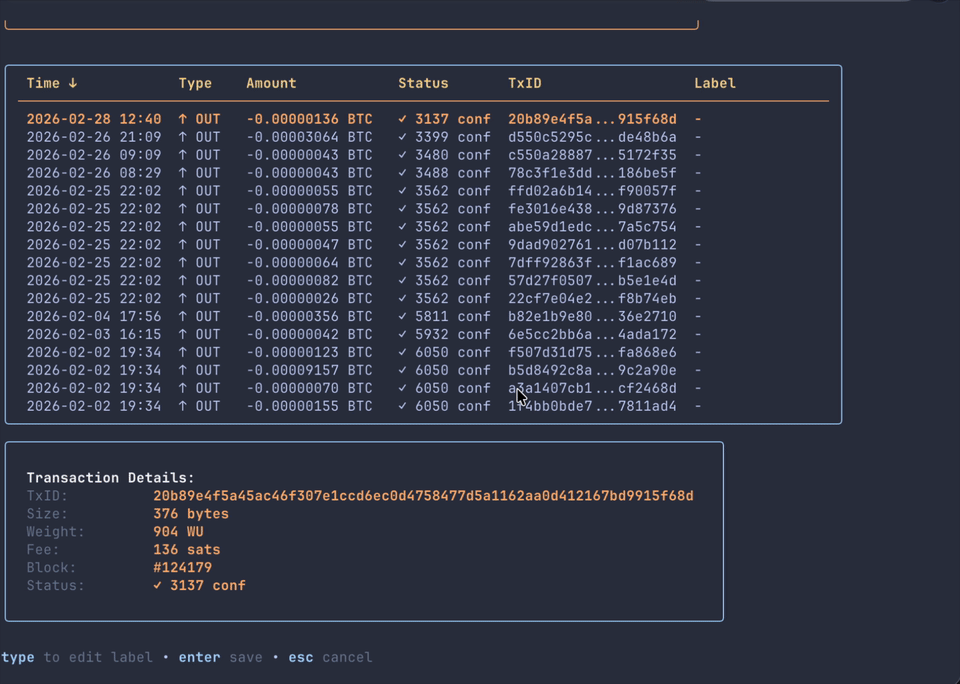

# hax

A free terminal Bitcoin wallet for testnet4, built with Go and Bubble Tea.

<p align="center">
  
</p>

The shipped binary is `hax`.

`hax` is for testnet4 right now. It is meant for trying wallet flows, PSBTs, and terminal-native Bitcoin UX without pretending to be a production wallet yet.




## What It Is

- Testnet4 only
- Free and source-first
- Good for trying wallet creation, restore, send, receive, and PSBT flows
- Not ready for mainnet or serious money yet

## Current Features

- HD software wallets with BIP32, BIP39, BIP44, BIP49, BIP84, and BIP86 support
- Taproot, native SegWit, nested SegWit, and legacy receive/send flows
- Multisig wallet setup and descriptor export
- PSBT creation, import, export, signing, and broadcast flows
- Hardware wallet support through HWI
- Coin control, send-all, labels, transaction history, and QR-based receive flows
- Electrum and Bitcoin Core backend support
- Local encrypted wallet storage using AES-256-GCM with PBKDF2-derived keys

## Build And Run

Prerequisites:
- Go 1.26.9 or newer
- A terminal with Unicode support

From source:

```bash
git clone https://github.com/BTCBap/hax.git
cd hax
make build
./hax
```

Useful commands:

```bash
make test
make build-release
make build-all
make checksums
DEBUG=1 ./hax
```

Wallet files are stored in `~/.hax/`.

## Current State

- The source repo is the main way to use it right now
- Official tagged binaries can come later
- Hardware wallet and multisig paths still need more real-world testing
- Mainnet support is a later goal, not current scope

If you want the deeper beta notes and validation docs, start in [docs/public-beta-checklist.md](docs/public-beta-checklist.md).
The short roadmap lives in [TODO.md](TODO.md).

## First-Time Use

1. Launch the app.
2. Create a new wallet or restore an existing seed phrase.
3. Set a wallet name and password.
4. Back up the recovery material before funding the wallet.
5. Use a testnet4 faucet before trying send, PSBT, or hardware wallet flows.

## Security

Security reporting guidance lives in [SECURITY.md](SECURITY.md).

Threat-model notes live in [docs/threat-model.md](docs/threat-model.md).

## Media Assets

- Dashboard preview: [screenshot1.png](screenshot1.png)
- Demo GIF: [docs/assets/hax-demo.gif](docs/assets/hax-demo.gif)
- Social preview source: [docs/assets/social-preview.svg](docs/assets/social-preview.svg)

## Contributing

Contribution guidelines live in [CONTRIBUTING.md](CONTRIBUTING.md).

## License

MIT. See [LICENSE](LICENSE).
