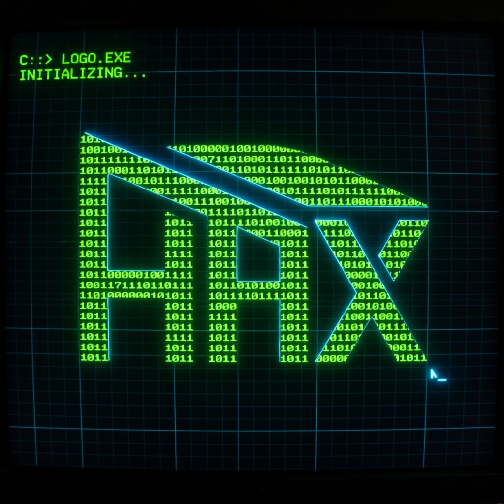
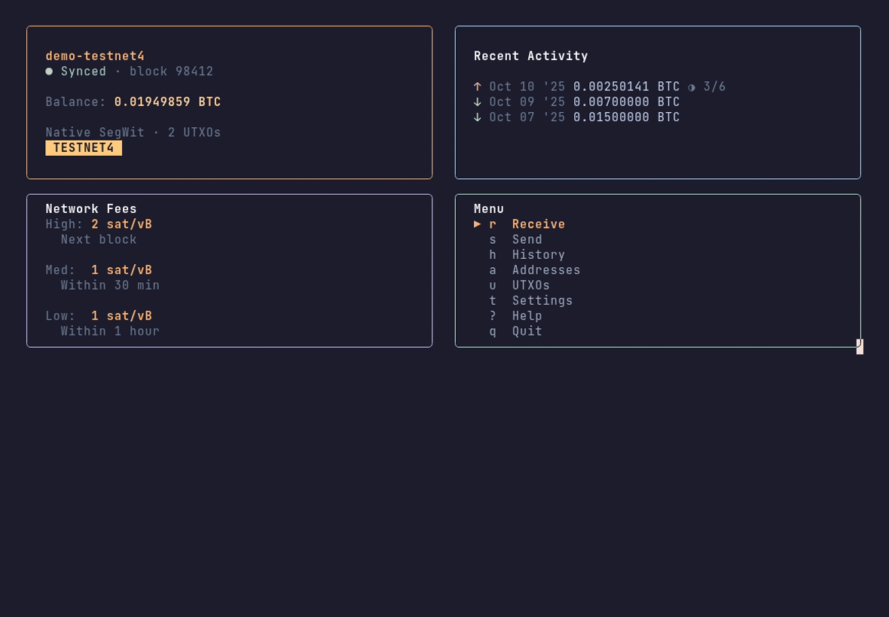
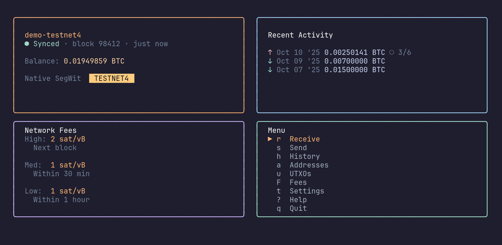
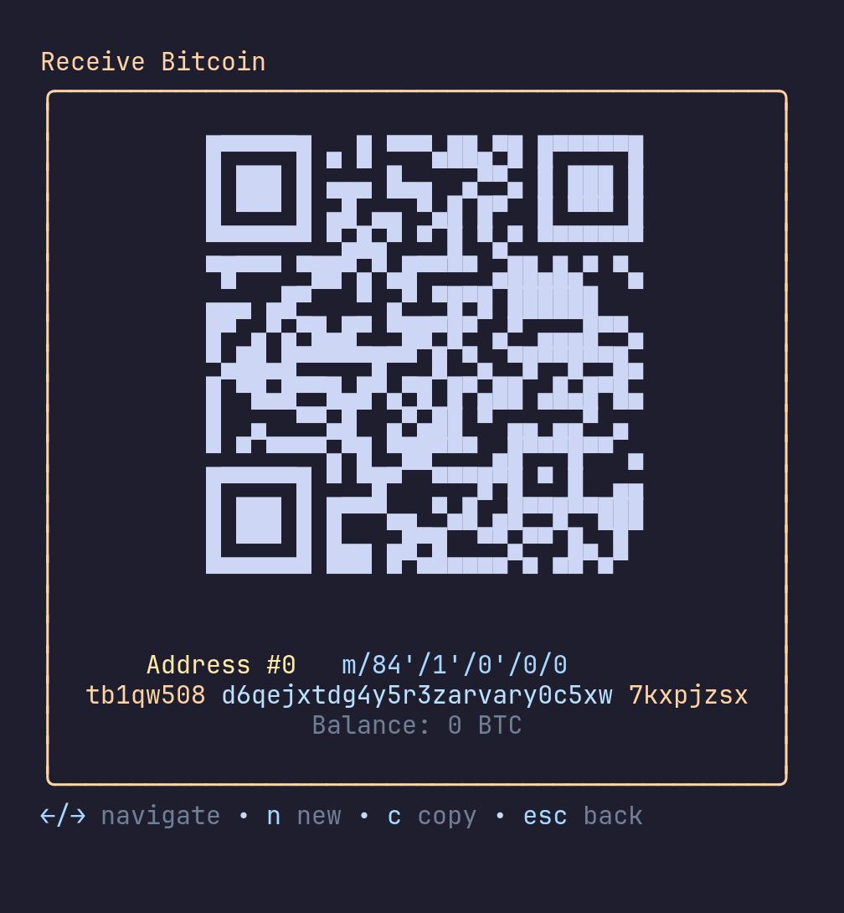
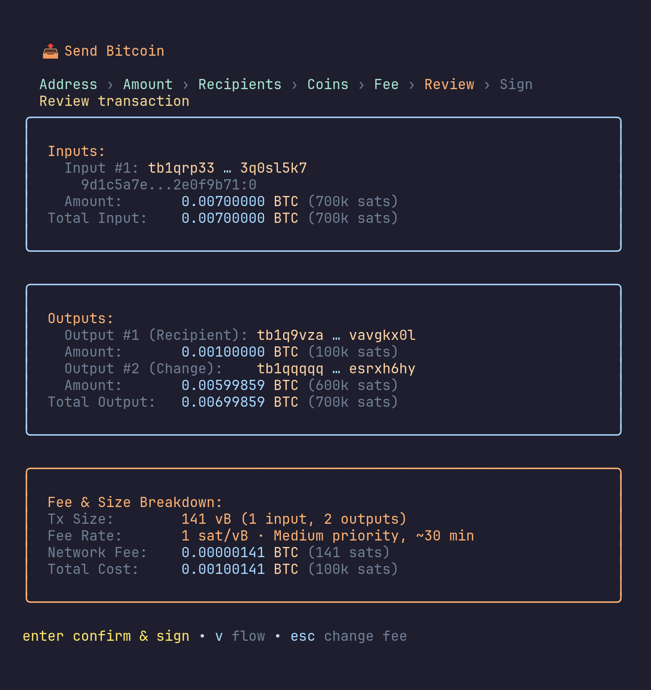
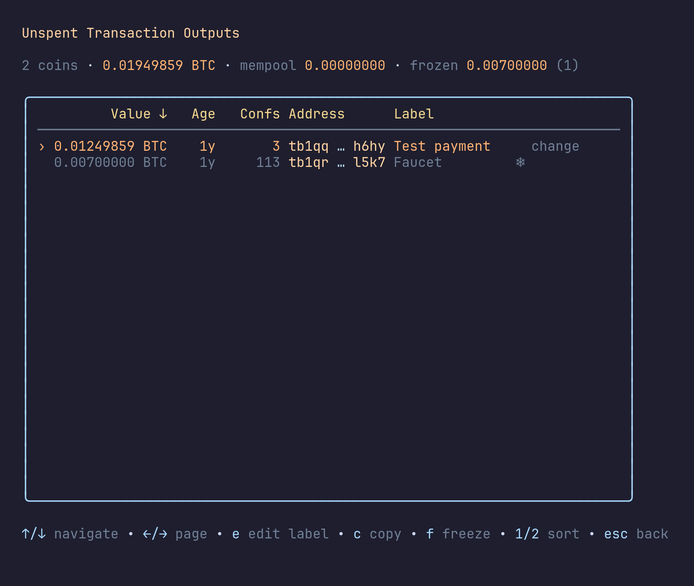
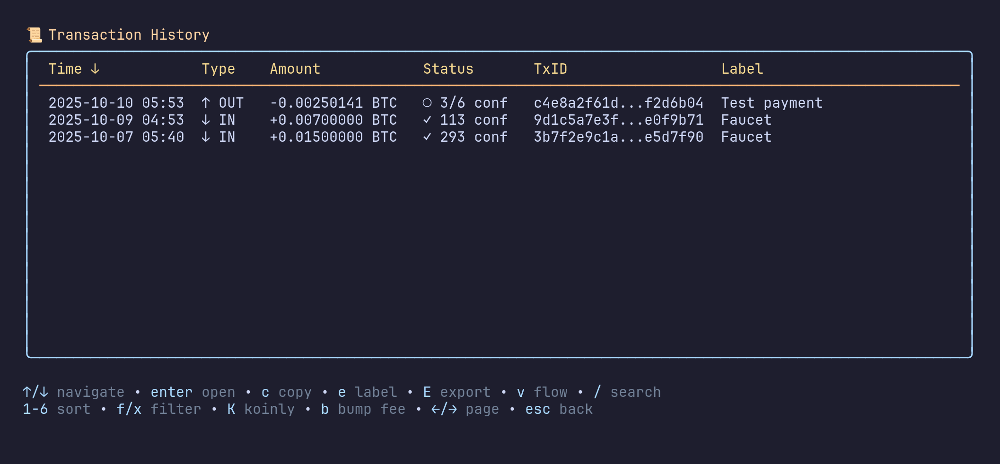
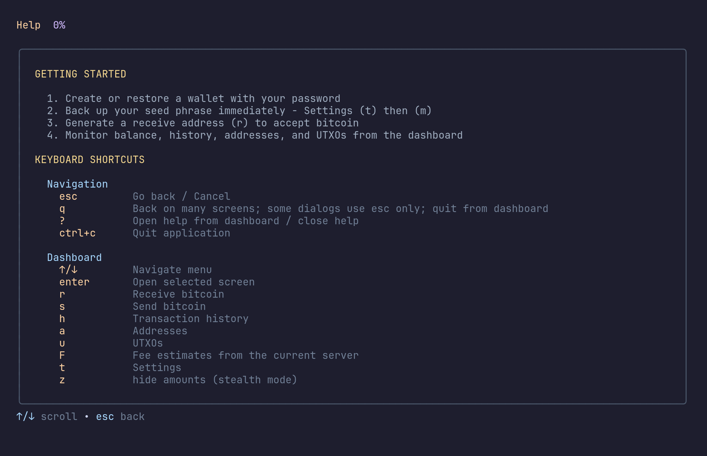
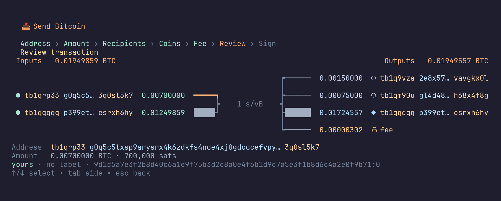
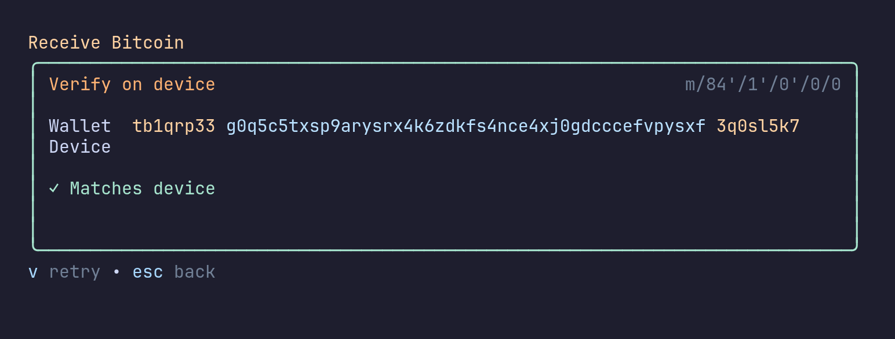

<p align="center">
  
</p>

<h1 align="center">hax</h1>

<p align="center">
  A terminal Bitcoin wallet: PSBT-first, hardware-wallet aware, multisig capable.<br>Supports mainnet and testnet4.
</p>

<p align="center">
  <a href="https://github.com/BTCBap/hax/actions/workflows/ci.yml"></a>
  <a href="https://github.com/BTCBap/hax/releases"></a>
  <a href="https://pkg.go.dev/github.com/BTCBap/hax"></a>
  <a href="LICENSE"></a>
</p>

> [!WARNING]
> **hax has not been independently audited.** Try it on testnet4 first.

<p align="center">
  
</p>

## Features

- **HD wallets:** BIP32/BIP39 with BIP44 (legacy), BIP49 (nested SegWit), BIP84 (native SegWit), and BIP86 (Taproot) accounts
- **Optional BIP39 passphrase**, stored only inside the encrypted wallet file
- **PSBT (BIP174)** create, import, export, sign, finalize, and broadcast, including animated QR (UR / BBQr) for air-gapped signers
- **Hardware wallets** through [HWI](https://github.com/bitcoin-core/HWI): Coldcard, Trezor, Ledger, BitBox02, Jade, KeepKey. Includes on-device address verification
- **Multisig:** BIP48 P2WSH / P2SH-P2WSH / P2SH, with Sparrow-compatible descriptor import/export
- **Coin control:** Branch-and-Bound selection, frozen coins, send-all, batch payments, and dust and fee-anomaly warnings at review
- **Fee bumping:** RBF and CPFP for pending transactions, and a PSBT inspector before every signature
- **Backends:** Electrum (TLS, optional Tor SOCKS5) or your own Bitcoin Core node over JSON-RPC (full history needs `-blockfilterindex=1`)
- **BIP21 payment URIs:** paste a `bitcoin:` link to fill the address, amount and label
- **BIP-329 labels** for transactions and addresses, searchable history, and Koinly CSV export
- **Encrypted at rest:** AES-256-GCM with an Argon2id-derived key (64 MiB, t=3, p=4). Wallets from older versions (PBKDF2) are migrated on unlock. Files are `0600` in a `0700` directory

| Dashboard | Receive |
|---|---|
|  |  |
| **Send review** | **UTXOs** |
|  |  |
| **History** | **Help** |
|  |  |
| **Transaction flow** | **Verify on device** |
|  |  |

## Install

### Quick install (release binary)

Download the archive for your system from https://github.com/BTCBap/hax/releases/latest.

| System | Asset |
|---|---|
| macOS Apple Silicon | `hax_1.4.0_darwin_arm64.tar.gz` |
| macOS Intel | `hax_1.4.0_darwin_amd64.tar.gz` |
| Linux x86_64 | `hax_1.4.0_linux_amd64.tar.gz` |
| Linux ARM64 | `hax_1.4.0_linux_arm64.tar.gz` |
| Windows x86_64 | `hax_1.4.0_windows_amd64.zip` |

```bash
tar -xzf hax_1.4.0_darwin_arm64.tar.gz   # use the file you downloaded
chmod +x hax
./hax
```

macOS: if Gatekeeper blocks it, run `xattr -d com.apple.quarantine hax` once.

Windows: unzip and run `hax.exe` from a terminal.

To check signatures and checksums before running, see [Verify a release download](#verify-a-release-download) below.

### Verify a release download

Each release publishes archives for Linux, macOS, and Windows, plus `checksums.txt`, a Sigstore bundle for it, and a SLSA build-provenance attestation.

Verify before running:

```bash
VERSION=v1.4.0   # the release you downloaded
# 1. Verify the checksum manifest was signed by this repo's release workflow
cosign verify-blob \
  --bundle checksums.txt.sigstore.json \
  --certificate-identity "https://github.com/BTCBap/hax/.github/workflows/release.yml@refs/tags/${VERSION}" \
  --certificate-oidc-issuer https://token.actions.githubusercontent.com \
  checksums.txt

# 2. Verify your archive against the manifest
sha256sum --ignore-missing -c checksums.txt     # macOS: shasum -a 256 -c checksums.txt

# 3. (optional) Verify build provenance
gh attestation verify hax_*_linux_amd64.tar.gz --repo BTCBap/hax
```

### `go install`

```bash
go install github.com/BTCBap/hax/cmd/hax@latest
```

### Build from source

Requires Go 1.26.9+ and a Unicode-capable terminal.

```bash
git clone https://github.com/BTCBap/hax.git
cd hax
make build          # ./hax
make test
make build-release  # -trimpath, version info injected
```

Release builds are reproducible; see [docs/release-verification.md](docs/release-verification.md).

## Usage

```bash
hax
```

On first run, hax asks you to pick a backend (Electrum or Bitcoin Core RPC). Then you can create or restore a wallet:

1. Create a wallet, write the seed phrase down on paper. Never store it digitally.
2. Choose an address type (native SegWit is the default).
3. Pick mainnet or testnet4. For testnet4 coins, use a faucet such as [mempool.space/testnet4/faucet](https://mempool.space/testnet4/faucet).
4. Use `r` to receive, `s` to send, `h` for history, `u` for UTXOs, `t` for settings, and `?` for all key bindings.

Set `DEBUG=1` to write a debug log. Never share debug logs publicly without reviewing them first.

## Configuration

All state lives in `~/.hax/`:

| Path | Contents |
|---|---|
| `~/.hax/<name>.wallet` | Encrypted wallet (seed, optional passphrase, accounts, labels, cache) |
| `~/.hax/known_servers.json` | Trusted Electrum server keys |
| `~/.hax/config.json` | Backend selection, display unit, gap limit, recent servers |
| `~/.hax/*_labels_bip329.jsonl`, `*_koinly.csv` | Exports (`0600`) |

## Security

Report vulnerabilities privately as described in [SECURITY.md](SECURITY.md).

## Contributing

See [CONTRIBUTING.md](CONTRIBUTING.md).

## License

[MIT](LICENSE)
